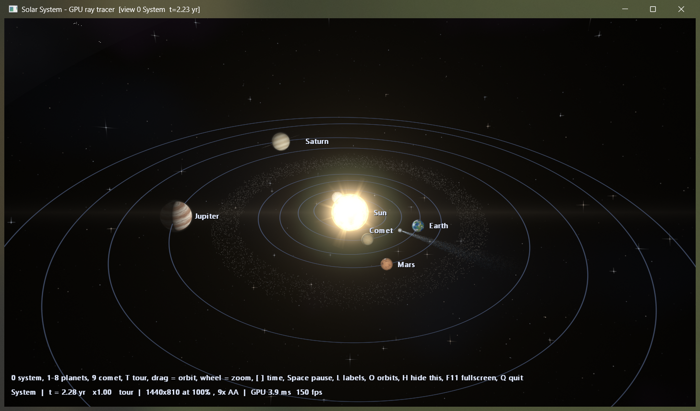
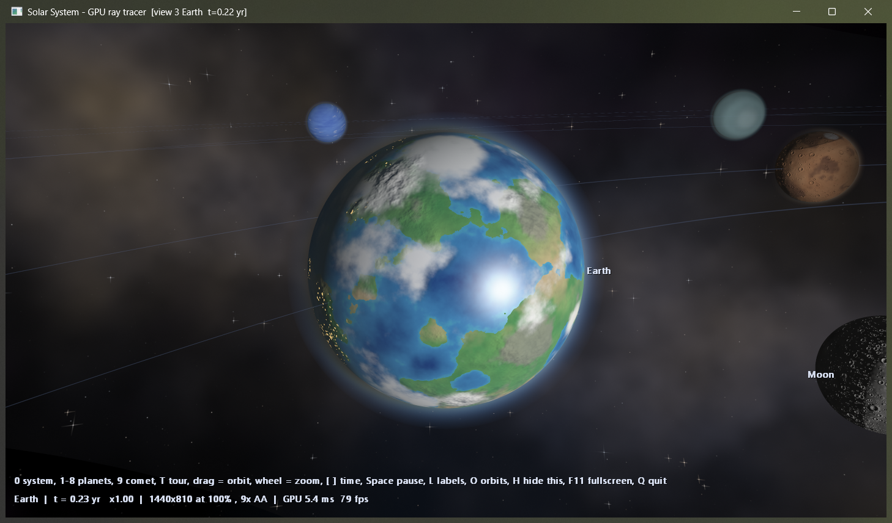
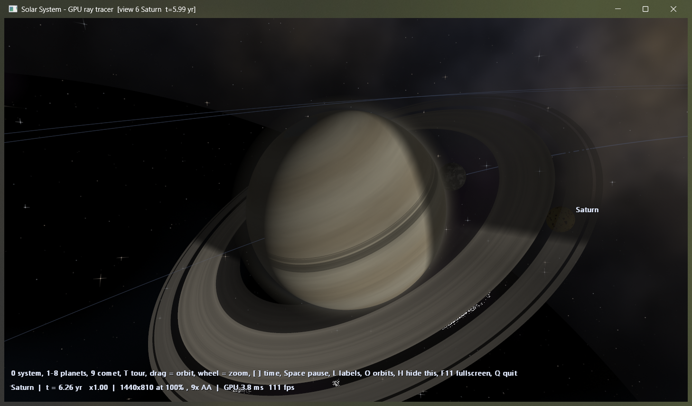
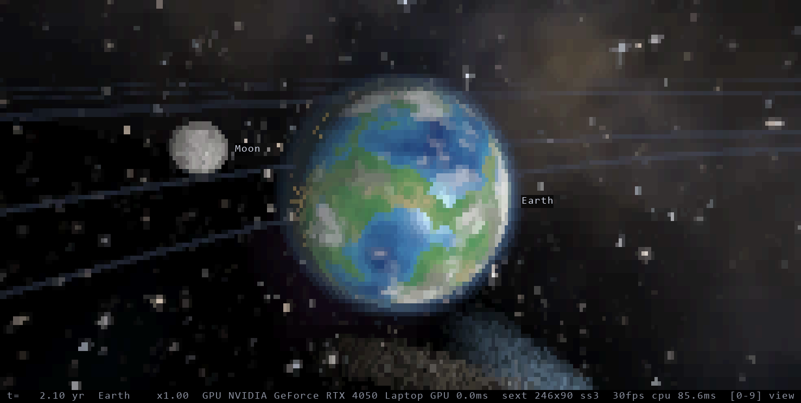

# solar-system

A 3D solar system for the terminal and for a native window, ray-traced on the GPU with Direct3D 11 compute shaders.

<p align="center">
  
</p>
<p align="center">
  
  
</p>

Three versions of the same scene, each one a step up:

| file | what it is |
|---|---|
| `solar.c` | first version: flat top-down view in colored ASCII |
| `solar3d.c` | CPU ray tracer in the terminal: lit and shadowed spheres, Saturn's rings, a comet, Unicode sextant output (2x3 sub-pixels per cell) |
| `solargpu.c` + `solargpu.hlsl` | the same scene ray-traced on the GPU. One source, two builds: a **terminal** build and a **native window** build |

A terminal is a grid of character cells, so a terminal build always has a visible pixel size. The window build draws at full resolution with no pixel blocks.

<p align="center">
  
</p>

## what the GPU version renders

- procedural planet surfaces with bump-mapped relief: craters on the Moon, Mercury, Mars and Callisto, mountains on Earth, cracked Europa
- ray-marched atmospheric scattering, cloud shadows, soft eclipse shadows, Saturn's ring shadows
- Sun corona and prominences, procedural stars and Milky Way, bloom
- a 3D asteroid belt and a comet on a real Kepler ellipse with an ion tail and a dust tail
- an auto tour of every planet and the comet

The window build also adds extra surface detail as you zoom in, a lens flare, mouse orbit, and dynamic resolution that lowers the render scale if a frame goes over its GPU time budget. The terminal build fits the best two colors per cell on the GPU and only rewrites the cells that changed.

Surfaces are procedural, not real maps, and the planets are ray-traced spheres, not meshes. Sizes and distances are artistic; orbital periods are real, and moon periods are slowed so they are watchable.

Measured on an RTX 4050 laptop GPU: about 3-5 ms of GPU time per frame in the window build at 1440x810 with 9 samples per pixel.

## build

Needs Windows and the MSVC compiler (`cl`).

```
cl /O2 /W4 /nologo solar.c
cl /O2 /W4 /openmp /nologo solar3d.c
```

The GPU version needs a GPU with Direct3D 11 compute (feature level 11_0), and `solargpu.hlsl` next to the exe. Compiled shaders are cached as `.cso` files beside it; the first run after a shader change takes about a minute to compile.

```
:: terminal build (Windows Terminal: truecolor, UTF-8, sextant glyphs)
cl /O2 /W4 /nologo solargpu.c

:: window build
cl /O2 /W4 /nologo /DWINDOWED /Fosolarwin.obj /Fe:solarwin.exe solargpu.c /link /SUBSYSTEM:WINDOWS /ENTRY:mainCRTStartup
```

Other options: `--view K` starts on view K with the tour off, `--fps N` caps the terminal frame rate, `--mode half|quad|sext` picks the terminal sub-pixel mode, `--frames N --size CxR` renders N frames to stdout and exits (used for testing).

## keys

`0` system view, `1`-`8` planets, `9` comet, `t` tour on/off (default on), arrows or `a` `d` `w` `s` orbit the camera, `+` `-` zoom, `[` `]` time speed, space pause, `l` labels, `o` orbit lines, `q` or Esc quit.

Terminal build: `m` cycles the sub-pixel mode.

Window build: drag with the mouse to orbit, wheel to zoom, F11 or double-click for fullscreen, `h` hides the on-screen help.
